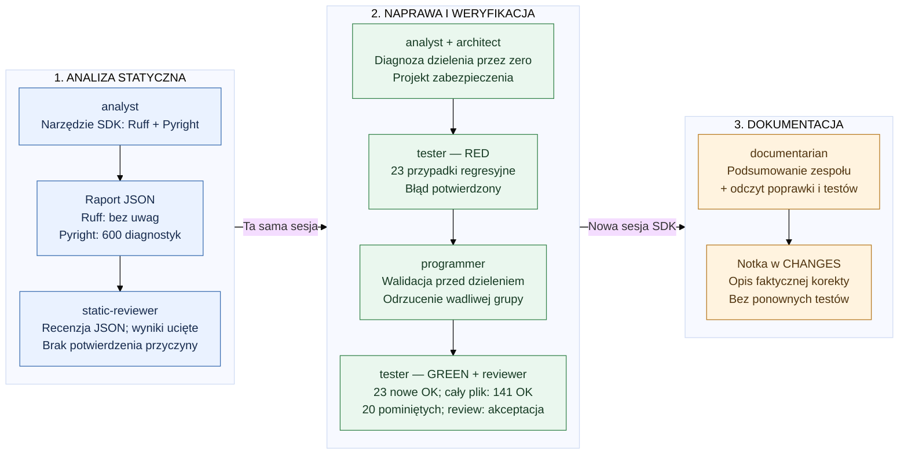

# Fabryka agentów SDLC — od diagnozy do dokumentacji

Beancount #1048: zero jednostek z kosztem całkowitym powoduje dzielenie przez zero.
Poniżej skrót rzeczywistego przebiegu z logu: **około 12 minut na jednym slajdzie**.

## Przebieg omawiania slajdu

1. **`DEFAULT_PROMPT` — diagnoza statyczna.** Orkiestrator deleguje przez
   `task`: analityk uruchamia narzędzie SDK `python_static_analysis`,
   potem recenzent dostaje cały
   zwrócony JSON. Raport ma uciętą listę diagnostyk Pyright; nie potwierdza
   przyczyny dzielenia przez zero. Na tym etapie nie ma edycji ani testów.
2. **`DEFAULT_REPAIR_PROMPT` — naprawa.** Druga tura tej samej sesji zachowuje
   kontekst. Specjaliści analizują kod, projektują zabezpieczenie, dodają testy
   RED, poprawiają kod i potwierdzają GREEN oraz akceptację review.
   Wynik: kontrolowany `InterpolationError: Amount is zero` zamiast wyjątku
   dzielenia przez zero, bez zmiany inventory przez wadliwą grupę.
3. **`DOCUMENTATION_PROMPT` — zamknięcie.** To nie kolejna delegacja `task`:
   Python tworzy osobną sesję z `agent="documentarian"` i przekazuje
   podsumowanie. Agent zmienia tylko `CHANGES`. Aplikacja zamyka sesję
   i klienta SDK; zmiany zostają do obejrzenia (`keep_changes=True`),
   bez commitowania ani wysyłania zmian przez demo.

## Na co zwrócić uwagę

- Trzy kolumny odpowiadają trzem promptom w [main.py](main.py), a nie trzem
  agentom; szczegółową kolejnością specjalistów steruje orkiestrator.
- Raport statyczny to dane z narzędzia, nie dowód odtworzenia błędu.
- RED → poprawka → GREEN to osobne przekazania pracy; końcowe review
  następuje po testach. 20 pominiętych testów nie oznacza 161 zaliczonych.
- Nowa sesja dokumentarzysty dostaje podsumowanie jawnie; nie dziedziczy
  automatycznie historii orkiestratora.

Źródło: [log przebiegu z 19.10.2026, 07:29:52–07:42:00 UTC](logs/summary20261019T072952.272306Z-4b13c439.log).
Diagram opisuje ten przebieg, nie gwarantuje identycznej sekwencji każdego uruchomienia.
